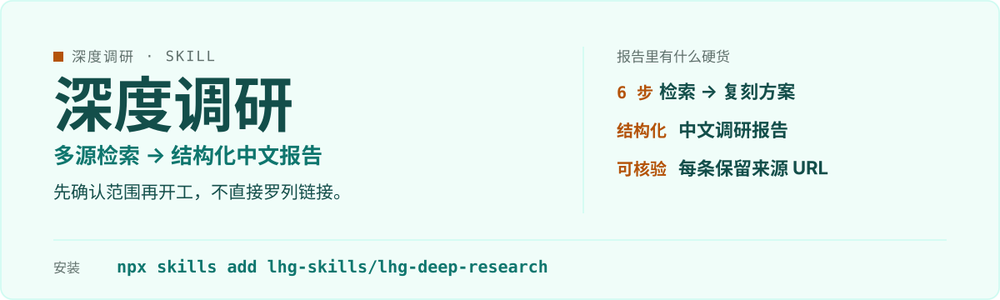

<p align="center">
  
</p>

# lhg-deep-research · 深度调研

输入一个主题，按多源检索 → 热度排名 → 作者深挖 → 需求提炼 → 功能分类 → 复刻/超越方案的流程，输出结构化中文调研报告。

（SKILL.md v1.1.2）

## 它是什么

- 六步流程，先确认范围再开工，不直接罗列链接。
- 输出结构化中文调研报告。
- 清单表含排名、名称、star 数（标注核实日期）、许可、作者、一句话简介，每条保留来源 URL。
- 隐私 / 侵权 / 灰色内容跳过并单列说明原因。

## 先试一句

| 你说 | 它给你 |
|---|---|
| 调研一下 X 赛道 | 先确认范围，再按六步出结构化报告 |
| 谁在做 X，这个项目能不能复刻 | 作者深挖 + 复刻 / 超越方案 |
| 做个竞品分析 | 多源检索 → 热度排名 → 功能分类，清单表附来源 URL |

## 安装

```bash
npx skills add lhg-skills/lhg-deep-research
```

<details>
<summary>发给 Agent 的安装话术（推荐：小白用户直接复制整段发给你的 Agent）</summary>

> 请帮我安装 Skill「lhg-deep-research」：先从 Gitee 上 lhg-skills 组织下的 lhg-deep-research 仓库下载；如果 Gitee 无法访问或下载失败，改从 GitHub 上 lhg-skills 组织下的同名仓库下载。按当前 Agent 的规范安装其中的 Skill，优先全局安装，保留完整目录和依赖。请直接执行，完成后验证是否安装成功，告诉我实际使用的来源、安装的版本号以及如何调用；遇到访问或安装限制请说明具体原因。需要输入管理员密码或确认风险时停下来等我。

**怎么算装好了**：Agent 能在已安装的 Skill 里看到 `lhg-deep-research`，并报出版本号（与仓库 `SKILL.md` 的 `version` 一致）。只是打开了仓库网页不算安装。

</details>


## 它怎么做

1. 确认调研范围
2. 多源检索
3. 热度排名
4. 作者深挖
5. 需求提炼
6. 功能分类
7. 复刻 / 超越方案
8. 结构化中文报告

## 什么时候用 / 不用

**用它，当你：**

- 调研一个赛道 / 领域
- 评估项目能不能复刻
- 要带来源 URL、可核验的竞品分析

**别用它，当你：**

- 只要几条链接——它输出的是结构化报告
- 范围没确认就开工——它会先问清范围
- 开放式取数走 lhg-net、热点走 lhg-trend

## 目录结构

```
SKILL.md            skill 全文
references/
  smoke-test.md     自检用例
docs/               补充文档
LICENSE             MIT
manifest.yaml
icon-512.png
```

## 自检与反馈

按 [references/smoke-test.md](references/smoke-test.md) 的用例验证：清单表字段完整（排名 / star 数 / 许可 / 作者 / 简介 / 来源 URL），隐私、侵权、灰色内容单列说明。

发现问题请提 issue：[提一个 issue](https://github.com/lhg-skills/lhg-deep-research/issues/new)（标题以 `[QC] ` 开头，写清你让它做了什么、它实际给了什么）。

---

## 出品：刘洪光

本 skill 由真人出镜 IP「刘洪光」（安徽合肥）出品，归属 [lhg-skills](https://github.com/lhg-skills)。

- GitHub 主页：https://github.com/lhg-skills —— 全部 skill 开源在此，欢迎 star
- 抖音：搜「刘老师讲AI实战」
- 微信：lhgsmsw

觉得有用，欢迎点 ⭐ Star。
